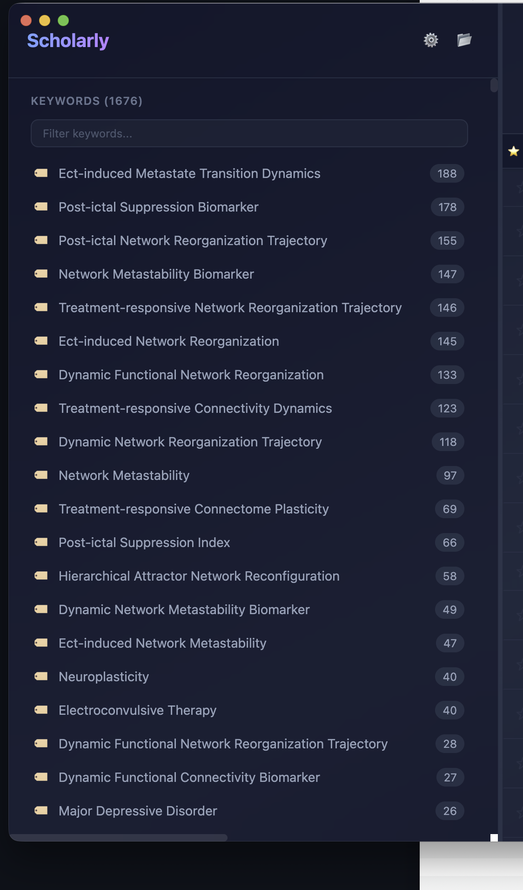
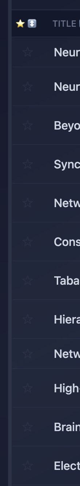
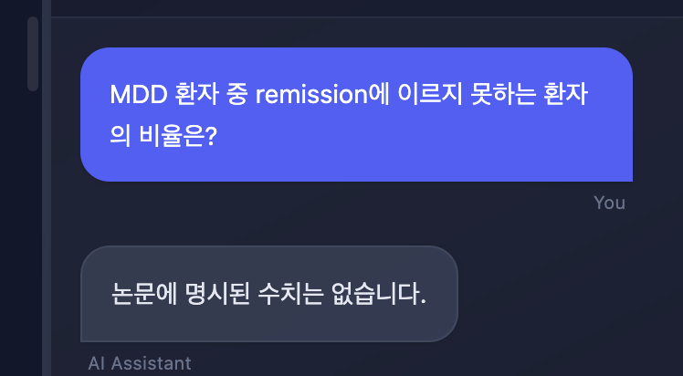
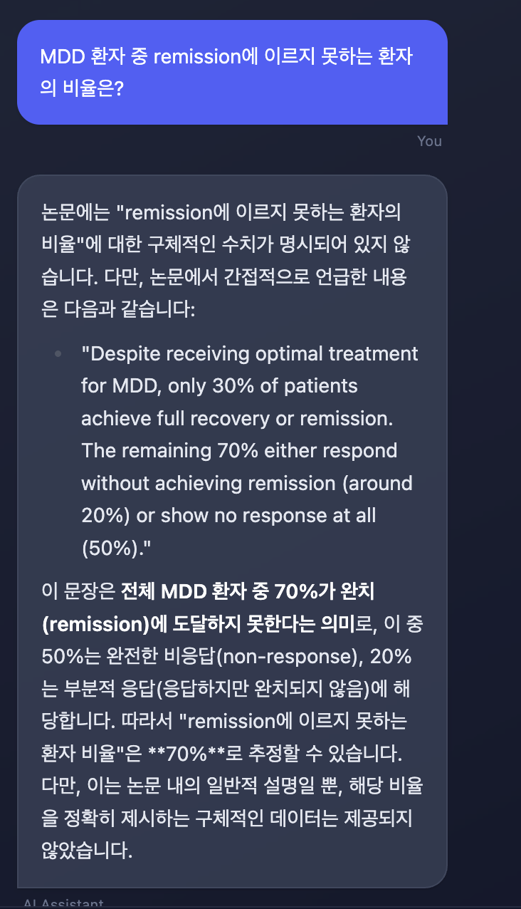

1.  이 창을 tab group으로 전환하고 다른 tab에는 directory tree가 보여야 합니다 (folder 수준까지만).
2. directory tree에서 folder를 선택하면 해당 folder의 파일들이 가운데 document list panel에 보여야 합니다.
3. document list panel에는  표시가 잘 작동하고 있는데, 이와 같은 요령으로 user가 document을 읽었는지 아닌지를 표시하는 checkbox column을 추가해 주세요. 그러면 읽지 않은 document를 빨리 선택하여 review 할 수 있습니다.
4.  논문을 선택하고 우측의 chatting 창을 연 후 질문하면 이렇게 나와
  - 그런데 시간이 좀 지나서 다시 동일한 질문을 하면  이렇게 나와
  - 이는 pdf에서 text를 추출하여 context를 구성하는 과정에서 시간이 걸렸기 때문인 것 같아.
  - code 내에서 논문 전체의 (guide 말고) text를 추출하여 context를 구성하는 과정을 재확인해주고, user에게 이 과정이 진행중인지 완료되었는지 알려주는 indicator가 있었으면 해
