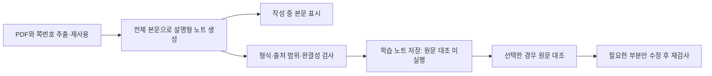

# Scholarly 학습 노트와 Rust 네이티브 앱 전환 계획

작성일: 2026-11-13 (Asia/Seoul). 이 문서는 최초 계획의 기록이다. 사용자의 실행 승인에 따라 학습 노트 개선·실제 논문 평가·Rust + GPUI Kit 구현을 진행했다. 현재 결과와 미완료 검증은 [평가 기록](../evaluation/2026-11-13-learning-native.md)과 [네이티브 앱 안내](../../native/README.md)를 따른다. 아래의 기준선·미실행 표현은 계획 작성 당시의 상태다.

## 1. 제품 방향

Scholarly의 주된 결과물을 '논문에서 배울 수 있는 설명형 학습 노트'로 바꾼다. 독자가 연구 질문, 주요 개념, 방법의 이유와 작동 과정, 핵심 근거, 저자의 결론을 자신의 말로 설명할 수 있어야 한다. 비판과 약점 발굴은 기본 작업에서 제외하되, 해석을 바꾸는 불확실성과 부정적 결과는 보존한다.

권고 순서는 학습 노트 품질·생성 속도를 먼저 개선하고, 같은 평가 자료를 이용해 Rust + GPUI Kit 버전으로 전환하는 것이다. 클라우드 모델의 생성 지연과 앱의 기동·화면 반응은 별도로 측정한다. Rust로 UI를 바꿨다는 사실만으로 원격 추론이 빨라지지는 않는다.

## 2. 현재 상태에서 확인한 사실

| 항목 | 확인 결과 | 변경에 주는 의미 |
|---|---|---|
| 실제 프롬프트 | `electron/services/digest.ts`, `scholarly-concise-digest-v4`; 한국어 350~550어절, 본문 3~5개 짧은 항목 | 학습에 필요한 설명이 부족해지는 직접적인 설계 요인 |
| 길이 검사 | 한국어 650어절 초과 시 간결성 경고 | 프롬프트만 늘리면 검사 기준과 충돌하므로 함께 수정 |
| 저장된 공급자 | 로컬 설정은 Codex, 모델명은 비어 있어 CLI 기본값 사용 | Ollama의 think 설정만 바꾸어서는 현재 경로가 개선되지 않음 |
| 구독 실행 | Codex를 `--ignore-user-config`로 매번 실행; 앱 자체 추론 강도 지정 없음 | 전역 설정 대신 요청마다 모델과 지원되는 effort를 명시해야 재현 가능 |
| 일반 논문 | 작성 1회 + 별도 원문 대조 1회; 수정하면 보통 총 4회 | 설명의 길이와 별도로 검증 지연이 존재 |
| 긴 논문 | 80,000문자 초과 시 50,000문자 구간별 순차 추출, 필요하면 순차 병합; 원문 구간별 대조 추가 | 문자 기준을 모델별 문맥 예산으로 교체하고, 독립 구간 처리만 제한적으로 병렬화 |
| 스트리밍 | Ollama `stream:false`; 구독 경로도 완성 응답 수집 | 읽기 시작 시점을 앞당길 여지가 있음. 전체 완료 시간이 줄어드는 것과는 구분 |
| 게시 조건 | `main.ts`에서 최종 본문 해시와 일치하는 검증 이력을 요구 | 1회 생성 모드는 기존 게시 규칙을 몰래 우회해서 만들 수 없음 |
| PDF 처리 | 물리적 쪽번호, 참고문헌 입력 제외, 텍스트 추출; 그림 직접 판독 없음 | 출처 연결은 보존하고 시각 자료를 읽었다고 표시하지 않음 |
| 설치 앱 | `/Volumes/Aquatope/Applications/Scholarly.app`: `du -sh` 약 345MiB, Frameworks 244MiB, Resources 101MiB | 프레임워크 제거와 리소스 정리가 모두 필요 |
| 리소스 | 설치 app.asar 약 88MiB; 소스의 테마 글꼴 폴더 합계 약 86MiB | 실제 번들 포함량을 따로 분석. 소스 폴더 크기를 그대로 절감량으로 계산하지 않음 |
| 기존 자료 | SQLite, PDF, `summary/*.md`, 읽음·중요 표시, 키워드, 대화 기록 | 재작성보다 데이터 호환성과 이관 검증이 중요 |

이번 조사에서는 생성 벤치마크를 실행하지 않았다. 기존 실패 진단 3건에는 요청별 측정 자료가 없어 추론·검증의 실제 소요 시간이나 개선 배수를 계산할 수 없었다. 현재 설치본의 실행 동작이 작업 트리와 동일하다고도 가정하지 않는다.

`DIGEST_MD_CONTRACT.md`에는 이전의 긴 세미나형 지침이 남아 있고, 실제 실행 프롬프트는 코드에 있다. 문서, 프롬프트, 검증기, 사용자 설정을 함께 버전 관리해야 한다. 작업 시작 전부터 존재하던 미커밋 변경은 별도 작업으로 보존한다.

## 3. 권장 프롬프트

실제 교체 후보는 [learning-note-v1.ko.txt](../prompts/learning-note-v1.ko.txt)다. 기존 설정의 '추가 지침'에 붙이는 것으로 충분하지 않다. 현재 시스템 프롬프트의 짧은 분량 규칙을 교체하고 검증·수정 프롬프트도 같은 목표로 맞춰야 한다.

- 일반 논문은 1,200~1,800 한국어 어절을 시험 출발점으로 한다. 복잡한 논문은 더 길게 허용하고 짧은 원문에 분량을 강제하지 않는다.
- 설명의 대부분을 원문의 논리와 방법·결과를 풀어 쓰는 본문에 사용한다. 개념 설명 → 접근/방법 → 관찰/논거 → 의미의 연결이 품질 기준이다.
- 핵심 실험과 논증을 보존하며, 사소한 예시·중복 요약·일반론을 줄인다. 글 길이만으로 통과·실패를 판정하지 않는다.
- 저장 형식의 기존 일곱 H1과 출처 표기는 우선 보존한다. 화면에서는 '한눈에 보기 / 먼저 알아둘 개념 / 연구 질문 / 본문 해설 / 핵심 결과 / 종합 이해 / 읽은 범위'로 표시할 수 있다.
- 비평을 생성하지 않는 것과 사실을 검증하지 않는 것은 별개의 선택이다. 원문의 불확실성과 결과를 바꾸는 한계는 두 모드 모두 보존한다.
- 학습 과정에서 '이 부분 풀어 설명하기'는 선택한 문단과 해당 원문만 보내는 별도 요청으로 만든다. 기본 노트의 충분한 설명을 후속 질문으로 떠넘기지 않는다.

## 4. 추론 설정과 속도 전략

### 4.1 추론 강도와 설명 분량을 분리

추론에 쓰는 시간은 낮추고, 독자에게 전달하는 설명은 충분히 쓴다. '생각하지 말라'는 문장을 프롬프트에 넣거나 추론 표시를 숨기는 방식은 추론 비활성화를 보장하지 않는다.

| 공급자 | 계획 | 주의할 점 |
|---|---|---|
| 현재 Codex 구독 | 모델을 명시적으로 기록하고 지원되는 최저 effort부터 비교; 보통 `low` 후보. 앱이 요청에 직접 설정 | 로컬 모델 메타데이터의 주요 모델은 `none`을 광고하지 않음. 이미 low라면 이 변경 자체의 절감은 없을 수 있음 |
| Ollama Cloud | 현재 `/v1/chat/completions`에 맞는 `reasoning_effort` 사용; 끄기 지원 모델만 `none` 검증 | 네이티브 `/api/chat`의 `think:false`와 다른 인터페이스. GPT-OSS 등은 완전 비활성화 불가 |
| Claude 구독 | 해당 CLI·모델이 지원하는 effort 제어를 구현 단계에서 확인하여 연결 | 모든 공급자에 같은 on/off 값을 보내지 않음 |

지원 능력을 확인할 수 없으면 '끄기 지원 미확인'으로 표시하고, 사용자에게 표시한 설정을 몰래 기본값으로 되돌리지 않는다. 요청한 값·실제로 확인된 값·모델 버전·CLI 버전을 기록한다. 출력 상세도 설정이 지원되는 경우만 별도로 사용하며, 주된 분량 제어는 학습 프롬프트가 맡는다.

근거: [Codex 설정](https://learn.chatgpt.com/docs/config-file/config-reference), [OpenAI 추론 설정](https://developers.openai.com/api/docs/guides/reasoning), [Ollama 호환 API](https://docs.ollama.com/api/openai-compatibility), [Ollama thinking](https://docs.ollama.com/capabilities/thinking). 실제 모델·클라이언트의 지원 여부를 구현 시 다시 확인한다.

### 4.2 기본 경로와 원문 대조 경로

목표 기본값은 '학습 노트': 일반 논문을 한 번의 생성으로 완성하고 앱 내부 검사를 거친다. 별도 모델 대조가 없다는 사실을 노트 상태로 드러낸다. '원문 대조'는 필요할 때 같은 노트를 검사하며, 논문을 비평하지 않는다. 최종 기본값 전환은 아래 품질 평가와 저장 계약 변경을 통과한 뒤 한다.

1. 일반적인 원문이 모델 문맥에 들어가면 전체 본문을 한 번에 읽힌다. 별도 계획 생성, 외부 검색, 개념 위키, 그림별 설명 생성은 기본 경로에 넣지 않는다.
2. 완성 답변의 텍스트를 가능한 공급자부터 점진적으로 표시한다. 작성 중인 노트는 임시 상태이며 완료 파일로 게시하지 않는다. 스트리밍은 읽기 시작 시간을 줄이는 방법이다.
3. 원문 대조는 1회 짧은 결과로 받고, 오류가 있으면 해당 문단을 우선 고친다. 변경된 문단과 관련 주장들을 재검사한다. 전체 논리나 여러 곳에 영향을 주는 변경은 전체 대조로 올린다. 수정·대조 반복은 제한한다.
4. 숫자·쪽번호의 존재, 언어, 비어 있는 본문, 불완전 종료, 파일 형식은 로컬에서 검사한다. 이 검사는 의미상 사실 정확성이나 빠짐없는 이해를 증명하지 않는다.
5. 형식만 고치면 되는 문제는 결정적 정규화로 처리한다. 짧다는 이유만으로 모델을 자동 반복 호출하지 않는다. 핵심 설명이 비어 있는 출력은 '보강 필요'로 분류한다.
6. 요청 실패 재시도와 내용 수정 횟수를 따로 제한한다. 취소가 모든 네트워크 요청과 구독 하위 프로세스에 전파되어야 한다.

### 4.3 긴 논문과 재사용

- 문자 수 고정 기준 대신 입력·지시문·출력·지원 모델의 추론 예산을 합한 문맥 예산으로 분기한다. 조용한 잘라내기는 금지한다. 추정만 가능한 토크나이저에는 여유를 둔다.
- 필요한 구간 분할은 문단·절·물리적 페이지 경계를 보존한다. 구간별 중간 자료에는 주요 개념, 실험/논증 ID, 절차, 결과, 정확한 수치와 조건, 페이지를 남긴다. 현재의 500단어 압축을 무조건 유지하지 않는다.
- 독립 구간 추출과 독립 대조는 먼저 동시 2개로 실험하고 공급자 제한에 맞춰 조절한다. 로컬 모델은 동시 1개가 더 빠를 수 있다. 순서를 복원해 합치고, 실패한 구간만 재시도한다.
- 추출 결과와 성공한 중간 자료는 재사용한다. 캐시 키에 PDF SHA-256, 페이지 범위, 추출 버전, 공급자/모델, 프롬프트 버전, 언어, 추가 지침, 깊이, 추론 설정을 포함한다. 의미에 영향을 주는 설정 변경을 누락하지 않는다.
- 완성 노트가 최신인지 먼저 판정해 불필요한 PDF 재추출을 줄인다. 기존 `pdf_context` 단일 텍스트를 페이지 정보가 완전한 추출 캐시와 동일하게 취급하지 않는다.
- 이미지가 결과 해석에 필수인 경우에만 해당 페이지를 시각 처리한다. 자동 그림 추출·OCR·이미지 이해는 별도 선택 기능으로 두고, 처리하지 않은 그림을 읽었다고 표시하지 않는다.
- 스트리밍 때문에 매 토큰마다 긴 문서 전체를 다시 파싱하지 않는다. 짧은 간격으로 갱신을 묶고 완성된 블록을 재사용한다.

대략적인 시간은 '전처리 + 각 요청의 대기·입력 처리·추론·출력 시간 + 대조·수정'의 합이다. 긴 답변은 출력 시간이 증가한다. 줄어드는 호출과 추론 시간이 그 증가분을 상쇄하는지는 실측으로 판정한다. '2배/10배 빨라짐'이나 논문당 고정 초 단위 완료 시간은 약속하지 않는다.

### 4.4 게시와 호환성

기존 `summary/<PDF>.md`는 대조를 통과한 정확한 본문에만 게시되는 경로다. 빠른 모드가 기존 검증 해시 요구를 우회하도록 수정하지 않는다.

첫 도입 단계에서는 1회 생성 결과를 별도의 `summary/<PDF>.learning.md`에 저장하고, 기존 검증 노트는 유지한다. 학습 파일은 새 계약 `scholarly-learning/v1`을 사용하며 `structural_validation_status`, `factual_review_status` (`not_run`, `passed`, `failed`), `generation_status`, 본문 해시를 분리한다. UI와 색인에서 '원문 대조 완료'와 '미실행'을 혼동하지 않는다.

ScholarPen 등 소비자가 새 계약을 처리하는지 확인한 뒤 정식 통합한다. 대조를 통과한 본문은 기존 v1 계약에 맞게 직렬화·검사하여 canonical summary로 승격할 수 있다. 논문 목록은 source ID를 기준으로 두 파일을 한 논문의 버전으로 보여 주며, 색인은 같은 노트를 중복 검색 결과로 반환하지 않는다. 기존 파일은 백업 또는 이전 버전으로 남긴다. 어느 경로든 취소·출력 잘림·쓰기 실패가 기존 파일을 교체하지 않는다.

## 5. Rust + GPUI Kit 설계

macOS Apple Silicon을 첫 출시 대상으로 가정한다. 기존 Windows/Linux 패키징 설정은 있으므로 다른 운영체제 지원을 완료했다고 표시하지 않는다. 운영체제 종속 부분을 분리하여 후속 이식을 가능하게 한다.

| 영역 | 책임과 선택 |
|---|---|
| 앱 셸 | 창, 메뉴, 단축키, 시작·종료, 기능 조립. 업무 로직을 한 엔티티에 몰지 않음 |
| 라이브러리 | 기존 SQLite 자료, 폴더 감시, 메타데이터, 키워드, 검색, 읽음·중요 표시, BibTeX/ZIP |
| 읽기 | PDF 입력, 노트 생성·검사·게시, 대기열, 재시작, 원문 대조 상태, 노트 화면 |
| 공급자 | Codex·Claude 공식 구독 연결 유지, Ollama Cloud HTTP, 스트림, 취소, 지원 설정과 측정 |
| 플랫폼 | PDF 처리, 파일 대화상자, Keychain, 외부 PDF 열기, 설치·서명 |

`native/` 아래 별도 Cargo workspace에서 시작한다. 앱 셸은 기능 모듈을 조립하고, 라이브러리·읽기 기능은 각각 상태와 명령·화면을 함께 소유한다. 읽기 엔진은 GPUI 없이 실행 가능한 경계를 갖춰 평가와 기존 구현 비교에 사용한다. 모든 화면이 하나의 거대한 상태를 공유하거나 React 구조를 그대로 옮기는 방식은 피한다.

- UI 프레임워크는 `gpui-kit`을 통해 사용하고, 확인한 릴리스와 의존성을 고정한다. 조사 시 upstream manifest는 0.9.1이다. 실제 배포 버전과 API는 착수 시 확정한다.
- `TextView`의 Markdown, 선택·복사, 표·링크를 먼저 검증한다. 일반 HTML 지원을 브라우저나 KaTeX의 완전한 대체로 보지 않는다.
- 수식 렌더링은 초기 기술 검증의 통과 조건이다. 네이티브 수식 렌더러 또는 LaTeX→SVG 캐시를 평가하고, 실패한 수식은 원문과 텍스트 대체를 제공한다. 완전한 수식 엔진이 이미 내장돼 있다고 가정하지 않는다.
- 현재 PDF 열기는 외부 앱을 사용한다. 첫 버전도 이를 유지할 수 있다. 텍스트 추출은 macOS PDFKit 기반의 좁은 브리지를 우선 평가하고, 다단 편집·표·물리적 쪽번호 정확도를 기존 추출과 비교한다. 내장 PDF 뷰어는 별도 범위다.
- 대규모 목록은 보이는 행만 렌더링하고, stable article ID를 유지한다. PDF·DB·네트워크 처리는 화면 스레드를 막지 않으며 문서 변경 후 도착한 오래된 결과를 버린다.
- 불필요한 언어 문법·편집기 기능·JavaScript 확장 런타임을 추가하지 않는다. 시스템 글꼴을 우선 사용하고 필요한 아이콘·수식 자산만 포함한다. release 최적화·심볼 분리는 크기와 기동을 함께 측정해 선택한다.
- 구독 CLI는 원격 호출용 외부 의존성으로 따로 보고한다. '앱이 작다'는 이유로 CLI 실행 중 메모리를 제외한 전체 작업 메모리를 제시하지 않는다.

근거: [GPUI Kit TextView](https://github.com/longbridge/gpui-kit/blob/main/website/component/text-view.md), [기능 선택 manifest](https://github.com/longbridge/gpui-kit/blob/main/crates/kit/Cargo.toml), [Apple PDFKit](https://developer.apple.com/documentation/pdfkit). Markdown 수식 플러그인 예제가 존재한다는 사실만으로 학술 수식 품질이 충족되었다고 판단하지 않는다.

## 6. 화면과 상호작용

핵심 작업은 논문을 고르고 학습 노트를 읽다가 필요한 부분을 질문하는 것이다. 읽는 본문이 창의 주된 공간을 차지한다.

- 기본 창은 접을 수 있는 폴더 영역, 가상화된 논문 목록, 넓은 읽기 영역으로 구성한다. 비어 있는 상태에서는 폴더 선택이 다음 행동으로 분명히 보인다.
- 읽기 영역 위에는 제목과 최소 메타데이터, '학습 노트 만들기', '원문 열기', 추가 명령 메뉴를 둔다. 논문 정보와 긴 실행 로그가 본문을 밀어내지 않게 한다.
- 본문은 적절한 행 길이·행간·한국어 글꼴을 사용한다. 목차·출처·대화는 필요할 때 여는 보조 영역으로 둔다. 긴 표는 표 영역에서 스크롤한다.
- 좁은 창에서는 폴더/목록을 접고 본문을 우선한다. 숨긴 기능에는 메뉴·단축키 경로가 남는다. 분할 폭과 읽던 위치는 저장하되 현재 창에 맞게 복원한다.
- 대기 중, 작성 중, 보강 필요, 원문 대조 중, 대조 미실행/완료, 취소, 실패를 실제 작업 상태에 맞춰 보여 준다. 진행률을 알 수 없을 때 가짜 백분율을 만들지 않는다.
- 완료된 글의 선택·복사, 한글 입력, 키보드 검색·탐색, Escape로 보조 화면 닫기와 초점 복원, 확대·축소, 밝은/어두운 테마를 실창에서 확인한다.
- 원문 쪽 열기는 실제 PDF 뷰어가 해당 페이지 이동을 지원하는 경우 연결한다. 지원하지 않으면 파일 열기와 해당 페이지 번호 표시를 제공한다.

## 7. 데이터와 기능 이관

1. 기존 Electron 앱의 DB·설정·대화·노트 위치를 목록화하고 SQLite 백업 기능으로 일관된 사본을 만든다. 실행 중인 DB 파일을 무작정 복사하지 않는다.
2. 개발용 네이티브 앱은 별도 앱 ID와 데이터 디렉터리에서 사본을 읽는다. 두 앱이 같은 DB에 동시에 쓰지 않는다. PDF 원본은 읽기 전용으로 참조한다.
3. 문서 ID, 경로, DOI, 키워드 관계, 읽음·중요 표시, 대화 메시지 순서와 시각, 노트/출처 해시를 비교한다. 모든 기존 사용자 기능의 이관 목록을 작성한다.
4. `safeStorage`로 암호화된 기존 키는 Rust에서 바로 읽힌다고 가정하지 않는다. 기존 앱을 통한 명시적 이관 또는 필요한 경우 1회 재입력으로 Keychain에 보관한다. 구독 자격증명은 공식 CLI 저장소에 둔다.
5. 원자적 노트 저장, 라이브러리 경로 이탈 방지, 의도치 않은 도구·웹 호출 차단, 취소 시 하위 프로세스 종료를 회귀 검증한다.
6. 이관이 완성된 후보 앱을 `/Volumes/Aquatope/Applications/`에서 실제 실행해 검사한다. 원본 앱과 데이터 백업을 유지하며 전환한다.

## 8. 구현 순서와 완료 조건

| 단계 | 작업 | 다음 단계로 넘어가는 조건 |
|---|---|---|
| 0. 기준선 | 대표 논문·현재 출력·공급자/모델·구간별 시간·설치 크기·실행 메모리 수집 | 어떤 품질과 시간을 개선하는지 재현 가능한 기준 확보 |
| 1. 학습 노트 | 새 프롬프트, 길이 검사, 검증·수정 프롬프트, 명시적 추론 설정, 실제 모델 기록 | 같은 논문에서 설명 연결과 원문 충실도 기준 통과 |
| 2. 빠른 읽기 | 공급자별 점진 표시, 캐시, 긴 문서 제한 병렬화, 새 계약의 1회 생성 모드 | 부분 출력/미대조 출력의 상태와 저장이 정확하고 기존 검증 모드 회귀 없음 |
| 3. 네이티브 기술 검증 | 실제 노트·긴 표·수식·한글 선택·입력, PDF 추출, 큰 목록, 취소 | 의미 있는 원문·수식 손실 없이 좁은 창에서도 핵심 작업 가능 |
| 4. 기능 이관 | 라이브러리, 노트, 공급자, 대화, 키워드, 내보내기와 데이터 사본 이관 | 기존 기능별 검증 및 자료 개수·관계·해시 일치 |
| 5. 성능·출시 | 번들 정리, 성능 측정, 서명·배포, 설치본 점검 | 목표 대비 실측 결과와 남은 제한을 명시하고 복구 경로 확보 |

프롬프트 품질 실험은 전체 네이티브 이식이 끝날 때까지 미루지 않는다. 전면 전환 전에 가장 위험한 수식·한글·PDF 처리를 먼저 검증한다.

## 9. 품질·속도 평가

대표 논문 6편으로 시작한다: 실증 2편(복수 실험 포함), 이론/개념 1편, 리뷰 1편, 수식 중심 방법 1편, 긴 논문 또는 책 장 1편. 별도로 스캔·잘린 본문 등 실패 입력을 사용한다.

같은 원문과 명시적 모델을 사용해 현재 concise, 새 학습 프롬프트+현재 effort, 새 학습 프롬프트+최저 지원 effort를 먼저 비교한다. 이후 1회 생성/원문 대조 여부를 비교해 원인을 분리한다. 초기 후보를 좁힌 뒤 유력 설정을 3회 반복하며, 소수 표본에서 부정확한 p95를 내세우지 않는다.

| 평가 | 방법 |
|---|---|
| 내용 충실도 | 사람이 원문에서 정리한 중심 개념·실험·논증·결론 목록과 대조 |
| 학습 가능성 | 원문 기반 이해 질문 5개에 노트만으로 답할 수 있는지 평가. 단어 수보다 설명 연결을 평가 |
| 사실 정확성 | 핵심 숫자·조건·출처·인과/불확실성 변형 검사; 중대한 오류가 남은 설정은 기본값 후보에서 제외 |
| 불필요한 내용 | 상투적인 비평, 반복 요약, 논문과 무관한 배경 설명 비중 |
| 생성 속도 | 추출, CLI 시작/요청 대기, 첫 읽을 만한 문단, 본문 완성, 대조, 수정, 최종 저장 시간을 분리 |
| 사용량 | 호출·재시도·입력·출력·추론 토큰을 공급자가 제공하는 범위에서 기록. 미제공은 추측하지 않음 |
| 앱 반응 | release 설치본의 첫 상호작용, 문서 열기·전환, 검색, 목록 스크롤, 긴 노트 선택·복사 |
| 앱 자원 | 번들/다운로드 크기, idle와 생성 중 전체 프로세스 메모리, CPU/GPU. 현재 Electron과 같은 자료·기기로 비교 |

네이티브의 초기 설계 목표는 앱 번들 100MiB 이하, 첫 상호작용 1초 이내, 일반 전환 100ms 이내다. 이는 측정 전 목표이며 보장치가 아니다. 첫 실행과 준비된 실행을 분리하고, 화면 성능은 좁은 창·확대 상태·큰 라이브러리에서도 확인한다. 수식 엔진과 PDF 처리 비용을 포함한 기술 검증 후 목표를 확정한다.

기본값은 가장 짧은 시간 자체가 아니라 학습 가능성과 원문 충실도 기준을 만족하는 후보 중 가장 빠른 설정으로 정한다. 형식 검사 통과나 동일 모델의 자체 검토만으로 품질을 보장하지 않는다.

## 2026-11-13 UI 보존 보정

사용자 피드백에 따라 초기 기능 중심 네이티브 화면을 폐기하고, 원래 Scholarly의 3단 화면·남색 팔레트·논문 표·상세 패널을 기준으로 다시 구현했다. 설치 후보와 확인/미확인 항목은 [네이티브 앱 안내](../../native/README.md)에 기록한다. 전체 전환 완료는 최종 앱 내부 검증 이후에 판정한다.
